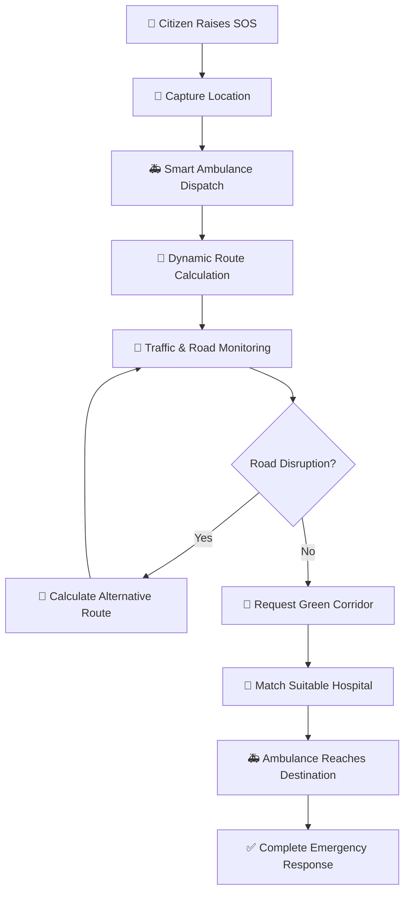
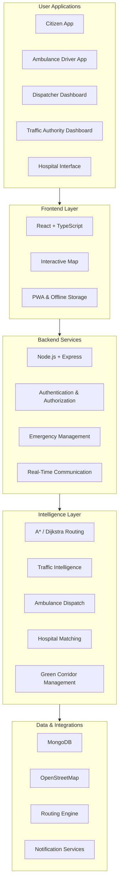

# 🚑 RouteResQ — Every Second Counts. Every Route Matters.

### AI-Powered Dynamic Transit & Emergency Re-Routing System

<p align="center">
  <strong>Smarter Emergency Response. Faster Routes. Better Coordination. Saved Lives.</strong>
</p>

<p align="center">
  
  
  
</p>

<p align="center">
  
  
  
  
</p>

---

## 🌍 Overview

Every second matters during an emergency. However, ambulances and other emergency vehicles frequently face traffic congestion, unexpected roadblocks, poor route coordination, and communication gaps.

**RouteResQ** is an intelligent emergency mobility and coordination platform designed to make emergency transportation faster, smarter, and more reliable.

It connects citizens, ambulance drivers, emergency dispatchers, hospitals, traffic authorities, and public transport systems through one unified platform.

Instead of simply finding a route, RouteResQ continuously evaluates road conditions, identifies disruptions, recommends alternative routes, coordinates emergency vehicle movement, and supports intelligent hospital selection.

Its goal is simple:

> **Reduce emergency response delays through intelligent routing, real-time coordination, and accessible emergency assistance.**

---

## 🚨 The Problem

Traditional emergency transportation systems face several challenges:

- 🚦 **Traffic Congestion:** Ambulances get delayed in heavily congested areas.
- 🚧 **Unexpected Roadblocks:** Accidents, construction, flooding, and road closures disrupt planned routes.
- 🏥 **Hospital Coordination:** Finding a suitable hospital with the required facilities can be difficult.
- 🚑 **Inefficient Dispatch:** Ambulance allocation may not account for real-time availability and suitability.
- 📡 **Network Limitations:** Emergency assistance becomes difficult when internet connectivity is unavailable.
- 🔄 **Poor Coordination:** Citizens, ambulance services, hospitals, and traffic authorities often operate independently.
- 🚌 **Public Transport Disruptions:** Road incidents also affect buses and everyday commuters.

**RouteResQ addresses these challenges through one integrated emergency mobility ecosystem.**

---

## 💡 Our Solution

RouteResQ introduces an intelligent system with seven major innovations:

| Innovation | What it does |
|---|---|
| 🧠 Dynamic Routing | Calculates efficient routes and automatically reroutes around disruptions. |
| 🚦 Intelligent Green Corridor | Coordinates emergency vehicle priority at traffic intersections. |
| 🚑 Smart Ambulance Dispatch | Recommends suitable available ambulances based on location and emergency needs. |
| 🏥 Smart Hospital Matching | Helps identify hospitals based on distance, facilities, and emergency requirements. |
| 📵 Offline One-Tap SOS | Stores emergency requests locally when connectivity is unavailable and synchronizes when possible. |
| 🌐 Multilingual Assistance | Supports accessible emergency interaction in English, Hindi, and Odia. |
| 👨‍👩‍👧 Remote Guardian | Helps authorized family members request assistance and monitor emergency progress with consent. |

---

## ✨ Key Features

### 1. 🚨 One-Tap Emergency SOS

Emergency assistance should be simple and accessible.

- One-tap emergency request.
- GPS-based location capture.
- Emergency category selection.
- Emergency description through text or voice.
- Emergency contact notifications when configured.
- Request status tracking.
- Option to call India's emergency helpline **112**.
- Last-known location support.
- Accessible emergency interface.

### 2. 🧠 Dynamic AI-Assisted Route Optimization

RouteResQ goes beyond conventional shortest-path navigation.

- Road-network graph-based routing.
- A* and Dijkstra pathfinding algorithms.
- Traffic-aware route calculations.
- Road closure and accident avoidance.
- Alternative route generation.
- Dynamic ETA recalculation.
- Route reliability and risk considerations.
- Automatic rerouting when road conditions change.

**Example:** If an ambulance encounters an unexpected road closure, RouteResQ can calculate an alternative path and update the estimated arrival time.

### 3. 🚦 Intelligent Green Corridor Management

Every second saved can make a difference.

RouteResQ introduces an emergency green corridor coordination workflow.

- Identify traffic intersections along an ambulance route.
- Request emergency traffic priority.
- Coordinate corridor approval with traffic authorities.
- Track corridor activation and progress.
- Handle conflicting emergency routes.
- Release priority after the vehicle passes.
- Maintain an audit trail of corridor decisions.

*Prototype traffic-signal operations are simulated. Actual signal control requires authorized integration with traffic infrastructure.*

### 4. 🚑 Smart Ambulance Dispatch

Find and allocate the most suitable available ambulance.

- Live or simulated ambulance tracking.
- Ambulance availability and status.
- Distance and ETA calculation.
- Emergency severity-based prioritization.
- Ambulance capability matching.
- Dispatcher-controlled assignment.
- Prevention of duplicate vehicle allocation.
- Assignment and response history.

### 5. 🏥 Intelligent Hospital Matching

Finding the nearest hospital is not always enough. The right hospital matters.

RouteResQ helps evaluate hospitals using:

- Distance and estimated arrival time.
- Available emergency facilities.
- Required medical specialties.
- ICU and bed availability, where verified data is integrated.
- Hospital readiness information.
- Suitability-based recommendations.

### 6. 📵 Offline-First Emergency Assistance

Network failure should not prevent users from preparing an emergency request.

- Progressive Web App (PWA) support.
- Cached application resources.
- Local emergency request storage.
- IndexedDB-based offline queue.
- Automatic synchronization after reconnection.
- Duplicate request protection.
- Last-known location support.
- Offline emergency guidance.

**Important:** Without an available communication channel, an offline request cannot reach the dispatch center or emergency services. RouteResQ stores it locally and attempts synchronization when connectivity returns. Direct emergency calls also depend on device and network availability.

### 7. 🌐 Multilingual & Voice Assistance

Emergency services should be accessible to everyone.

Initial language support:

- English
- हिंदी (Hindi)
- ଓଡ଼ିଆ (Odia)

Accessibility features:

- Multilingual interface.
- Voice-based emergency input where supported.
- Speech-to-text.
- Text-to-speech.
- Voice guidance.
- Clear emergency instructions.
- Screen-reader-friendly interface.

### 8. 👨‍👩‍👧 Remote Guardian

Help families coordinate emergency assistance for their loved ones.

- Authorized family contacts.
- Remote emergency request.
- Consent-based location sharing.
- Emergency status notifications.
- Ambulance tracking.
- Emergency progress updates.

### 9. 🚌 Smart Public Transport Coordination

Road disruptions affect more than emergency vehicles.

- Public transport route monitoring.
- Bus location and status.
- Traffic disruption awareness.
- Alternative route suggestions.
- Estimated delay information.
- Passenger notifications.

### 10. 📊 Emergency Analytics & Insights

Provide useful insights to dispatchers and authorities.

- Emergency response time.
- Ambulance utilization.
- Route optimization performance.
- ETA accuracy.
- Road disruption statistics.
- Green corridor usage.
- Hospital selection trends.
- Offline request synchronization statistics.

---

## 🔄 How RouteResQ Works



### Example Emergency Scenario

1. A citizen reports a medical emergency using the SOS feature.
2. RouteResQ captures the available location information.
3. The dispatch system recommends a suitable available ambulance.
4. A dispatcher confirms the assignment.
5. The routing engine calculates an efficient route.
6. A roadblock is reported or detected.
7. The system recalculates the route and updates the ETA.
8. Traffic authorities receive a green corridor request.
9. A suitable hospital is recommended.
10. The emergency response is completed and recorded.

---

## 🏗️ System Architecture



---

## 🛠️ Technology Stack

The following is the intended technology stack; update it to reflect the technologies actually implemented in your repository.

| Layer | Technology | Purpose |
|---|---|---|
| Frontend | React.js | User interface |
| Language | TypeScript / JavaScript | Application development |
| Styling | Tailwind CSS | Responsive UI |
| Backend | Node.js | Server-side runtime |
| API | Express.js | REST APIs |
| Database | MongoDB | Application data |
| Real-Time | Socket.IO | Live updates |
| Mapping | Leaflet | Interactive maps |
| Map Data | OpenStreetMap | Geographic data |
| Routing | A* / Dijkstra | Pathfinding |
| Routing Service | OSRM / GraphHopper | Route and road-network support |
| AI Integration | Gemini API | AI-assisted capabilities where implemented |
| Offline Storage | IndexedDB | Local emergency data |
| PWA | Service Workers | Offline application support |
| Charts | Recharts | Analytics and visualization |
| Notifications | Firebase Cloud Messaging | Push notifications where configured |

---

## 🧮 Algorithms & Intelligence

### A* Pathfinding

A* identifies promising paths by considering both the cost already travelled and an estimated remaining cost.

\[
f(n)=g(n)+h(n)
\]

Where:

- \(g(n)\): Cost from the starting node.
- \(h(n)\): Estimated cost to the destination.
- \(f(n)\): Total estimated path cost.

### Dijkstra's Algorithm

Dijkstra's algorithm finds shortest paths in a weighted graph with non-negative edge weights.

### Dynamic Route Weights

Road segments can be assigned dynamic weights based on factors such as:

- Travel time.
- Traffic congestion.
- Road closures.
- Accident reports.
- Road conditions.
- Vehicle restrictions.

The routing engine can recalculate routes when these conditions change.

---

## 🖥️ Application Modules

| Module | Primary User |
|---|---|
| Citizen Emergency Interface | Citizens |
| Emergency Command Center | Dispatchers |
| Live Operations Map | Dispatchers & Authorities |
| Ambulance Driver Interface | Ambulance Drivers |
| Traffic Management Dashboard | Traffic Authorities |
| Hospital Coordination | Hospitals |
| Public Transport Monitoring | Transport Operators |
| Remote Guardian | Authorized Family Members |
| Analytics Dashboard | Administrators |

---

## 🔐 Security & Privacy

Emergency information must be handled responsibly.

RouteResQ is designed around:

- Role-based access control.
- Secure authentication.
- Authorized location sharing.
- User consent.
- Protected API endpoints.
- Secure communication.
- Emergency activity logs.
- Controlled access to sensitive information.
- Responsible data retention.

Production deployment requires security testing, privacy review, and appropriate operational authorization.

---

## 🚀 Getting Started

Follow these instructions to run the project locally once the application code is available.

### Prerequisites

- Node.js (LTS)
- npm
- Git
- MongoDB or a configured database service

### 1. Clone the Repository

```bash
git clone https://github.com/YOUR_USERNAME/RouteResQ.git
```

### 2. Navigate to the Project

```bash
cd RouteResQ
```

### 3. Install Dependencies

```bash
npm install
```

### 4. Configure Environment Variables

Create a `.env` file using the variables required by your implementation.

```env
PORT=5000
MONGODB_URI=your_mongodb_connection_string
JWT_SECRET=your_secure_secret
GEMINI_API_KEY=your_gemini_api_key
```

Do not commit real API keys, database credentials, or secrets to GitHub.

### 5. Start the Application

Use the scripts defined in your project's `package.json`.

For example:

```bash
npm run dev
```

*Note: Commands and environment variables may need adjustment depending on your actual frontend/backend folder structure.*

---

## 🎯 Target Applications

RouteResQ can support a range of emergency mobility scenarios:

- 🚑 Ambulance and medical emergencies.
- 🚒 Fire and rescue services.
- 🚓 Police and law enforcement.
- 🌊 Flood and disaster response.
- 🚧 Road accident management.
- 🚌 Public transportation coordination.
- 🏙️ Smart city traffic management.

---

## 🌟 What Makes RouteResQ Different?

| Traditional Navigation | RouteResQ |
|---|---|
| Focuses mainly on navigation | Focuses on the complete emergency response workflow |
| Limited emergency coordination | Connects citizens, dispatchers, drivers, hospitals and authorities |
| Route guidance | Dynamic emergency route optimization |
| No integrated corridor workflow | Green corridor request and coordination |
| Limited offline emergency workflow | Offline SOS storage and synchronization |
| Basic destination search | Hospital suitability matching |
| Individual vehicle navigation | Multi-ambulance resource coordination |

**Our biggest difference:** RouteResQ does not just help an ambulance find a road. It helps coordinate the emergency journey from SOS to hospital arrival.

---

## 🛣️ Future Roadmap

- [ ] Complete citizen SOS application.
- [ ] Interactive live operations map.
- [ ] Dynamic route optimization.
- [ ] Real-time ambulance tracking.
- [ ] Smart ambulance dispatch.
- [ ] Green corridor simulation.
- [ ] Offline-first emergency workflow.
- [ ] English, Hindi and Odia support.
- [ ] Hospital matching and readiness integration.
- [ ] Voice-based emergency assistance.
- [ ] Remote Guardian functionality.
- [ ] Public transport coordination.
- [ ] Traffic intelligence and predictive analysis.
- [ ] Authorized real-world traffic and emergency service integrations.
- [ ] Multi-city deployment.

---

## 🧪 Prototype & Demonstration

The prototype can demonstrate an emergency scenario using a sample city such as **Sambalpur, Odisha**.

Suggested demonstration flow:

1. Open the Emergency Command Center.
2. View ambulances, hospitals and road conditions on the map.
3. Create an emergency SOS request.
4. Assign an available ambulance.
5. Calculate the initial route.
6. Introduce a simulated roadblock.
7. Observe automatic route recalculation.
8. Request green corridor approval.
9. View the recommended hospital.
10. Demonstrate offline request storage and synchronization.

*Demonstration data, simulated traffic, and simulated integrations should be clearly distinguished from verified live services.*

---

## 🤝 Contributing

Contributions and suggestions are welcome!

1. Fork the repository.
2. Create a feature branch.

```bash
git checkout -b feature/your-feature-name
```

3. Commit your changes.

```bash
git commit -m "Add: your feature description"
```

4. Push your branch.

```bash
git push origin feature/your-feature-name
```

5. Open a Pull Request.

---

## 👥 Team

**Project:** RouteResQ  
**Tagline:** Every Second Counts. Every Route Matters.  
**Domain:** AI | Smart Mobility | Emergency Response | Smart Cities  
**Developed for:** Software Hackathon

Add your team members and contribution roles here.

---

## ❤️ Our Vision

We envision a future where emergency vehicles are not left struggling through traffic, citizens can request help even in challenging network conditions, hospitals are better coordinated, and cities respond to emergencies intelligently.

RouteResQ aims to transform emergency mobility from disconnected services into one coordinated, intelligent response ecosystem.

<p align="center">
  <strong>🚑 We don't just find faster routes. We help cities respond smarter.</strong>
</p>

<p align="center">
  <strong>RouteResQ — Every Second Counts. Every Route Matters.</strong>
</p>

---

<p align="center">
  Made with ❤️ for safer and smarter cities.
</p>
